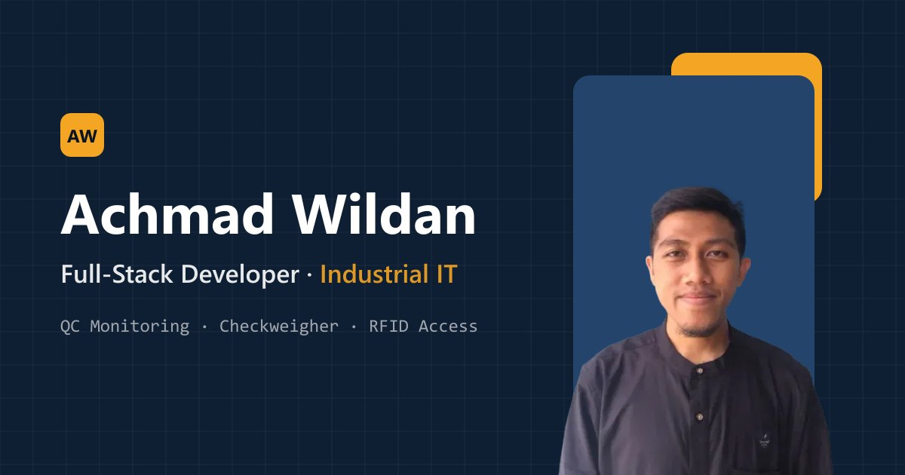

# Achmad Wildan — Portofolio

Website portofolio pribadi yang menampilkan proyek, pengalaman, dan kontak saya sebagai **Full-Stack Developer di bidang Industrial IT**.

🔗 **Live:** https://achmadwildan.github.io/branding-page/



## Isi

- **Projects**: sistem yang saya bangun untuk lingkungan produksi (QC monitoring, aplikasi penimbangan, kontrol pintu RFID, dashboard produksi berbasis AI) serta proyek pembelajaran IDCamp/Dicoding. Proyek yang punya video dilengkapi demo.
- **Resume**: pengalaman kerja, pendidikan, dan tech stack.
- **Contact**: email, WhatsApp, GitHub, LinkedIn.

## Tech Stack

- HTML, CSS (Bootstrap 5 + tema custom), JavaScript
- Font: Space Grotesk (judul), Plus Jakarta Sans (teks), JetBrains Mono (label)
- [Vite](https://vitejs.dev/) untuk development & build
- Di-deploy ke GitHub Pages dari folder `docs/`

## Menjalankan Secara Lokal

```bash
npm install
npm run dev      # server development di http://localhost:5173
npm run build    # build ke folder docs/
npm run preview  # preview hasil build
```

## Struktur

```
src/
├── index.html        # halaman utama
├── main.js           # entry point Vite
├── js/scripts.js     # interaksi: carousel, modal video, scroll spy, animasi
├── css/bootstrap.css # Bootstrap 5 (vendor)
├── css/styles.css    # tema custom: warna, bentuk, komponen
├── assets/           # foto (WebP), video demo, favicon
└── public/           # file statis tanpa hash (og-image.jpg)
docs/                 # hasil build (GitHub Pages)
```

## Kontak

- Email: wildan044@gmail.com
- LinkedIn: [achmadwildan-](https://www.linkedin.com/in/achmadwildan-/)
